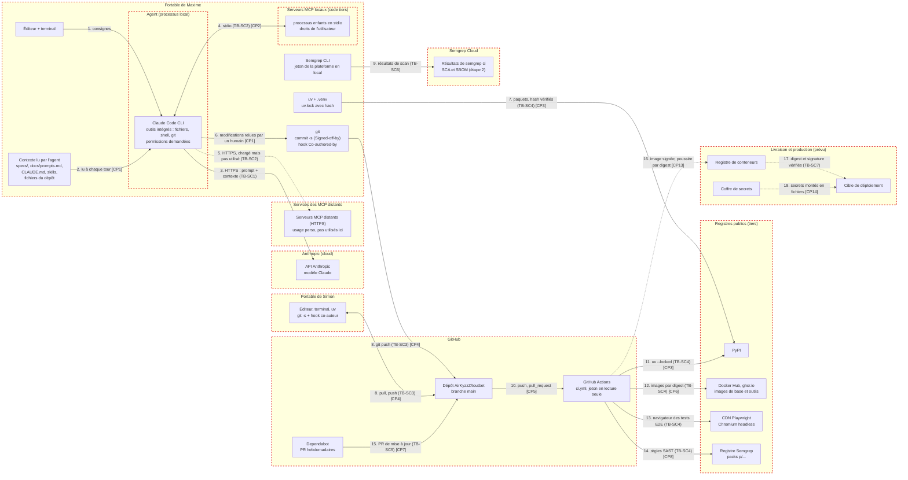

# Atelier 3, étape 1 : environnements et supply chain

Version du 2026-11-25. On suit le chemin réel du code de ToutBet', du clavier jusqu'à la production, en incluant l'agent qui a écrit la plus grande partie du code. Pour chaque passage on note qui peut modifier quoi, et le contrôle qui l'en empêche ou le détecte.

## 1. Schéma

Même convention que `specs/design.md` : chaque cadre rouge en pointillés est une zone de confiance, un flux qui en sort franchit une frontière (`TB-SC1` à `TB-SC7`, §2). Les `[CPn]` renvoient aux points de contrôle du §4. Les flèches en pointillés et la zone « prévu » n'existent pas encore.

Comment le code a vraiment été produit :

- Les commits partent du portable de Maxime, en binôme avec Simon. Chaque commit porte `Signed-off-by` (`git commit -s`) et un hook `prepare-commit-msg` ajoute `Co-authored-by: Simon Godard`. Simon a le même outillage sur son portable.
- On a fixé les choix produit et la stack, puis fait rédiger les specs par l'agent (P0). Le code a été généré par l'agent à partir des specs seules (P1), revu par une session neuve (R1) et corrigé (P2 à P4). Tous les prompts sont dans `docs/prompts.md`.
- L'agent est Claude Code, une CLI qui tourne dans le terminal du portable avec nos droits. Le modèle, lui, tourne chez Anthropic : à chaque tour la CLI lui envoie le prompt, l'historique et tout ce qu'elle a lu (fichiers, sorties de commandes). C'est donc toute la zone « contexte » qui sort du poste.
- uv installe Python 3.13 et les dépendances depuis PyPI en vérifiant les hash de `uv.lock`. Les images Docker viennent de Docker Hub et de ghcr.io, figées par digest.
- La CLI Semgrep, connectée à notre organisation, envoie les résultats de `semgrep ci` à Semgrep Cloud. La CI, elle, n'a pas de jeton et lance Semgrep OSS.
- GitHub Actions lance `.github/workflows/ci.yml` à chaque push et pull request sur `main`. Dependabot propose les mises à jour chaque semaine.
- Le registre de conteneurs, le coffre et la cible de production ne sont pas encore construits.

## 2. Frontières de confiance

| TB | Entre | Ce qui passe | Contrôles au franchissement |
|---|---|---|---|
| TB-SC1 | portable et API Anthropic | specs, code, sorties de commandes, tout le contexte de l'agent | dépôt public et sans donnée réelle, secrets hors du dépôt, `.env` limité à des secrets de dev générés ; prévu : interdire à l'agent de lire `.env` |
| TB-SC2 | agent et serveurs MCP | appels d'outils dans un sens, texte non fiable dans l'autre | outils intégrés seulement pour ce projet, permissions demandées par la CLI ; prévu : liste blanche MCP par projet (§5) |
| TB-SC3 | portables et GitHub | commits, branches | compte GitHub avec 2FA, `Signed-off-by` et co-auteur, revue avant commit ; prévu : commits signés, protection de `main` |
| TB-SC4 | portables et CI vers les registres publics | code tiers qui entre dans le build et les tests | `uv.lock` avec hash et `--locked`, images par digest, actions par SHA, version de Playwright figée |
| TB-SC5 | contributions non relues (PR, fork, Dependabot) et `main` | code qui n'a pas encore été relu | déclencheur `pull_request` seulement, jeton en lecture seule, aucun secret dans la CI, CI complète sur chaque PR ; prévu : checks obligatoires et revue requise |
| TB-SC6 | portable et Semgrep Cloud | résultats de scan, extraits de code, liste des dépendances | jeton gardé en local, jamais dans le dépôt ni dans la CI |
| TB-SC7 | CI, registre et production (prévu) | l'image qui sera exécutée | prévu : image construite seulement en CI, signée, vérifiée par digest avant déploiement |

## 3. Menaces sur l'environnement

Même grille STRIDE que `specs/threats.md`. Le statut dit si le contrôle principal existe déjà dans le dépôt.

| ID | Catégorie | Menace identifiée | Composant visé | Mitigation | Statut |
|---|---|---|---|---|---|
| T-SC01 | Usurpation | Typosquatting (`request` au lieu de `requests`) ou dependency confusion (paquet public au nom d'un paquet interne) | `pyproject.toml`, `uv.lock` | Dépendances choisies dans `design.md` et relues, PyPI comme seul index, `uv.lock` avec hash, `uv lock --check` et `--locked` en CI, `test_forbidden_dependencies_absent`. Pas de paquet interne, donc pas de nom à usurper aujourd'hui | En place |
| T-SC02 | Altération | Paquet PyPI légitime compromis (compte mainteneur volé, nouvelle version piégée) | 81 paquets de `uv.lock` | Versions et hash figés, aucune montée de version sans PR, Dependabot avec 7 jours d'attente (`cooldown`) pour laisser le temps à une version piégée d'être retirée, CI complète sur la PR, SCA Semgrep (étape 2). Prévu : proxy de paquets (Nexus, Artifactory) | En place / prévu |
| T-SC03 | Altération | Action GitHub référencée par un tag que son auteur ou un attaquant déplace (cas `tj-actions/changed-files` en 2025) | `ci.yml` | Chaque action figée par SHA de commit complet avec la version en commentaire, règle `github-actions-mutable-action-tag` du pack `p/github-actions` dans le job Semgrep, Dependabot met à jour SHA et commentaire, versions publiées depuis plus de deux semaines quand c'est possible | En place |
| T-SC04 | Altération | Image de base remplacée sous le même tag | `Dockerfile`, `docker-compose.yml`, conteneurs de la CI | Toutes les images figées par digest sha256 (uv, python, caddy, postgres, semgrep, gitleaks), digests revérifiés le 2026-11-25, Dependabot `docker` et `docker-compose` | En place |
| T-SC05 | Élévation | Workflow `pull_request_target` ou PR depuis un fork qui exécute son code avec un jeton en écriture ou les secrets du dépôt | GitHub Actions | Déclencheur `pull_request` seulement (un fork n'a ni secret ni jeton en écriture), `permissions: contents: read`, `persist-credentials: false`, aucun secret utilisé, règle `pull-request-target-code-checkout` dans Semgrep. Prévu : approbation manuelle des workflows des nouveaux contributeurs | En place |
| T-SC06 | Divulgation | Jeton ou secret qui fuit dans l'historique Git ou dans les logs publics de la CI | dépôt, logs Actions | `.env` ignoré par Git et Docker dès le premier commit, gitleaks sur tout l'historique à chaque push et PR avec `--redact` (un secret trouvé n'est pas recopié dans le log public), secrets de test générés à chaque lancement, mots de passe PostgreSQL de la CI jetables. Prévu : push protection de GitHub | En place |
| T-SC07 | Altération | Fichier de contexte piégé (`CLAUDE.md`, skill, spec, README d'une dépendance) ou réponse d'outil MCP qui glisse des consignes à l'agent (injection indirecte) | Claude Code, contexte | Contexte de génération limité aux `specs/` versionnées et relues (P1 sans MCP ni doc externe), prompts versionnés, revue humaine de chaque diff, l'agent ne pousse jamais. Prévu : `CLAUDE.md` et skills relus comme du code, liste blanche MCP | En place / prévu |
| T-SC08 | Divulgation | L'agent écrit un secret dans un fichier commité (valeur de `.env` recopiée dans un test ou un doc) | dépôt | Consignes des prompts (`git add <chemins>`, jamais `-A`), revue du diff, gitleaks en CI, secrets de dev seulement sur le poste | En place |
| T-SC09 | Altération | L'agent affaiblit un test pour faire passer la CI (`skip`, assertion retirée, limite relevée) | `tests/` | Revue humaine des diffs de tests, chaque menace reliée à ses tests dans le `README.md`, étape de la CI qui échoue si `test_pg_grants.py` est ignoré au lieu de passer. Prévu : `CODEOWNERS` sur `tests/` et `.github/` avec revue obligatoire | En place / prévu |
| T-SC10 | Divulgation | Données envoyées à l'API Anthropic avec le contexte (secret lu dans `.env`, sortie de commande) | Claude Code vers API | Dépôt public, aucune donnée réelle, `.env` local avec des secrets de dev jetables. Prévu : règle `deny` sur `Read(./.env)` dans les permissions Claude Code du projet | Prévu |
| T-SC11 | Élévation | Agentivité excessive : l'agent a aussi des outils personnels (messagerie, cloud, tickets) et peut agir ou exfiltrer si une injection le pousse | configuration MCP du poste | Permissions demandées par la CLI avant chaque outil non autorisé. Prévu : liste blanche MCP par projet (§5) | Prévu |
| T-SC12 | Altération | Fausse PR Dependabot (branche `dependabot/...`, auteur imité) ou vraie PR vers une version piégée | PR sur `main` | Pas de fusion automatique, CI complète, vérifier l'auteur `dependabot[bot]` et le diff de `uv.lock` (source, hash), `cooldown` de 7 jours. Prévu : checks requis et revue obligatoire sur `main` | En place / prévu |
| T-SC13 | Altération | Image modifiée entre la CI et le déploiement (registre compromis, tag écrasé) | registre, cible | Prévu : image construite seulement en CI, poussée et déployée par digest, signature cosign sans clé (OIDC) et attestation de provenance (`actions/attest-build-provenance`), vérification avant déploiement, tags immuables dans le registre | Prévu |
| T-SC14 | Usurpation | Vol du jeton Semgrep : lecture de la liste de nos failles, envoi de faux résultats | poste, Semgrep Cloud | Jeton créé par `semgrep login` et gardé sur le poste, jamais dans le dépôt ni dans la CI, CI en Semgrep OSS sans jeton (`semgrep scan --metrics=off`), révocation dans l'interface Semgrep | En place |
| T-SC15 | Altération | Navigateur Playwright piégé (CDN compromis, cache Actions empoisonné) | job E2E | Version de Playwright figée et hachée dans `uv.lock` (elle fixe la révision de Chromium), téléchargement en HTTPS depuis le CDN officiel, cache indexé sur cette version, caches des PR isolés de `main` par GitHub. Prévu : image Playwright officielle figée par digest comme conteneur du job | En place / prévu |
| T-SC16 | Élévation | Portable compromis : un malware vole la session GitHub ou la clé SSH et pousse sur `main` | postes, dépôt | 2FA GitHub, revue avant commit. Prévu : protection de `main` (PR obligatoire, checks requis), commits signés exigés | Prévu |
| T-SC17 | Répudiation | On ne sait plus qui a écrit un commit (identité Git libre, humain ou agent) | historique Git | `Signed-off-by`, co-auteur ajouté par hook, prompts et modèle de chaque étape dans `docs/prompts.md`, push par compte GitHub authentifié. `Signed-off-by` n'est pas une signature cryptographique. Prévu : commits signés (SSH ou gitsign) | En place / prévu |
| T-SC18 | Déni de service | CI bloquée ou qui consomme toutes les minutes (job qui pend, runs empilés) | GitHub Actions | `timeout-minutes` sur chaque job, `concurrency` avec `cancel-in-progress`, caches uv et navigateur | En place |

| Catégorie | Nombre |
|---|---|
| S, Usurpation | 2 |
| T, Altération | 8 |
| R, Répudiation | 1 |
| I, Divulgation | 3 |
| D, Déni de service | 1 |
| E, Élévation de privilèges | 3 |
| Total | 18 |

Un point qui ne mérite pas sa propre ligne : les packs publics `p/...` sont téléchargés depuis le registre Semgrep à chaque run, sans version. Une règle retirée ferait baisser la détection sans bruit. Le moteur est figé par digest et nos trois règles sont versionnées avec leurs tests, ce qui suffit pour le MVP.

## 4. Points de contrôle

| CP | Où | Contrôle | Statut |
|---|---|---|---|
| CP1 | agent | Revue humaine de chaque diff avant commit, prompts et contexte versionnés dans `docs/prompts.md`, contexte de génération limité aux specs | En place |
| CP2 | agent et outils | Permissions demandées par la CLI avant shell, écriture ou outil MCP. Prévu : liste blanche MCP par projet | En place / prévu |
| CP3 | dépendances Python | `uv.lock` avec hash, `uv sync --locked` dans le `Dockerfile` et la CI, `uv lock --check` en CI | En place |
| CP4 | commits | `Signed-off-by`, hook co-auteur, 2FA. Prévu : commits signés, protection de `main` | En place / prévu |
| CP5 | workflow CI | Actions par SHA, `permissions: contents: read`, `persist-credentials: false`, pas de `pull_request_target`, timeouts, `concurrency` | En place |
| CP6 | images | Digest sha256 dans le `Dockerfile`, le compose et la CI | En place |
| CP7 | mises à jour | Dependabot hebdomadaire, groupé, 7 jours d'attente, passage par PR et CI | En place (actif au premier push) |
| CP8 | SAST | Semgrep OSS : 7 packs de l'atelier 2, `p/github-actions` et nos 3 règles, échec à la première alerte | En place |
| CP9 | secrets dans Git | gitleaks sur tout l'historique, `--redact` | En place |
| CP10 | tests | Unitaires, abus, E2E Playwright, suite complète sur PostgreSQL avec le rôle restreint | En place |
| CP11 | SCA et SBOM | Semgrep Supply Chain | Étape 2, à faire |
| CP12 | fusion sur `main` | Protection de branche, checks requis, revue, `CODEOWNERS` | Prévu (réglage GitHub) |
| CP13 | image livrée | Build en CI, signature et attestation, vérification par digest avant déploiement | Prévu |
| CP14 | secrets d'exécution | Coffre et OIDC, secrets lus en fichiers dans `/run/secrets` (voir `secrets.md`) | Lecture en fichiers en place, coffre prévu |

### Ce qu'on a fait à cette étape

- **Images figées par digest.** C'était déjà le cas depuis P1 pour les deux étapes du `Dockerfile` (`ghcr.io/astral-sh/uv:0.13.6`, `python:3.13-slim`) et pour le compose (`caddy:2`, `postgres:17`). On a revérifié le 2026-11-25 avec `docker buildx imagetools inspect` : les quatre digests sont toujours ceux des tags, rien à changer. Les images ajoutées par la CI (service PostgreSQL, Semgrep 1.186.0, gitleaks 8.30.1) sont figées de la même façon. On n'a pas vérifié que Dependabot suit les images déclarées dans un workflow, on les mettra à jour à la main avec celles du compose.
- **Installation qui échoue si le lock dérive.** Le `Dockerfile` fait déjà `uv sync --locked` (deux fois) avec `UV_PYTHON_DOWNLOADS=never`. La CI ajoute `uv lock --check` et `--locked` sur chaque commande uv.
- **Dependabot.** `.github/dependabot.yml` couvre `uv`, `github-actions`, `docker` et `docker-compose`, chaque semaine, une PR groupée par écosystème, avec 7 jours d'attente après la sortie d'une version et des préfixes de commit conventionnels (`build`, `ci`).
- **CI durcie** (étape 3) : voir `README.md` de ce dossier.

## 5. Serveurs MCP

Le dépôt est public, donc cette partie reste générique.

Claude Code tourne en local, dans le terminal, avec les droits de l'utilisateur, et appelle l'API Anthropic. Un serveur MCP ajoute des outils à l'agent, sous deux formes :

- en local, un processus lancé par la CLI qui lui parle en stdio. C'est du code tiers qui tourne avec nos droits sur le portable ;
- à distance, un service joint en HTTPS, souvent avec un jeton OAuth du compte de l'utilisateur.

Sur ce projet, le travail sur le code n'a utilisé que les outils intégrés de Claude Code (lecture et écriture de fichiers, shell, git) et la CLI Semgrep. D'autres serveurs MCP, configurés sur le poste pour un usage personnel (messagerie, agenda, fournisseurs cloud, gestion de projet), étaient chargés dans le même agent sans être utiles ici.

Pourquoi c'est un risque :

- **Injection indirecte.** Tout texte qui entre dans le contexte peut contenir des consignes que le modèle risque de suivre : un fichier du dépôt, la réponse d'un outil, un mail lu par un outil de messagerie, et même la description des outils d'un serveur MCP. Plus l'agent a d'outils branchés sur l'extérieur, plus il y a d'entrées non fiables.
- **Agentivité excessive.** L'agent dispose d'outils dont la tâche n'a pas besoin. Un outil cloud peut créer ou supprimer des machines, un outil de messagerie peut envoyer des messages en notre nom. Une injection réussie hérite de tous ces droits.
- **Exfiltration par un outil.** Un outil qui écrit vers l'extérieur (envoyer un mail, créer un ticket, écrire dans un document partagé) suffit pour sortir le contenu de `.env` ou du code, sans aucune requête réseau suspecte côté poste.

Contrôle proposé :

- **Liste blanche MCP par projet.** Un `.mcp.json` versionné dans le dépôt qui ne déclare que les serveurs utiles au projet (ici aucun), Claude Code lancé sur ce dépôt avec `--strict-mcp-config` pour ignorer les serveurs configurés au niveau de l'utilisateur, et des règles `deny` sur les outils MCP sensibles dans les réglages du projet. La liste est relue en PR comme le reste.
- **Permissions demandées par la CLI.** Chaque appel d'outil qui n'est pas autorisé d'avance (commande shell, écriture, outil MCP) demande une confirmation. On garde ce mode sur ce dépôt, on ne pré-autorise que des commandes en lecture ou les commandes de test, et on refuse la lecture de `.env`.

Ces deux mesures ne sont pas encore appliquées dans le dépôt : statut prévu dans le tableau (T-SC07, T-SC10, T-SC11).
