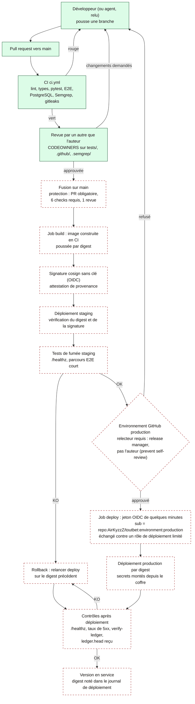

# Atelier 4, étape 1 : identités et privilèges

Version du 2026-11-25. On part du modèle de supply chain de l'atelier 3 (`docs/ateliers/atelier3/supply-chain.md`) : mêmes zones, mêmes menaces `T-SC01` à `T-SC18`. Pour chaque zone on dit qui peut faire quoi, puis comment on passe en production, puis comment on coupe les accès de quelqu'un qui part.

Aujourd'hui l'équipe, c'est nous deux. Maxime tient le rôle de lead dev et Security Champion, Simon celui d'ops et release manager, et on est tous les deux développeurs. La matrice décrit les rôles, pas les personnes : une même personne peut avoir deux rôles, mais jamais sur le même changement (voir la séparation des tâches plus bas).

## 1. Matrice des privilèges

Légende :

| Valeur | Sens |
|---|---|
| ✅ | autorisé en permanence |
| PR | seulement par une pull request relue et approuvée par quelqu'un d'autre que l'auteur |
| JIT | accès juste à temps : demandé pour une tâche, approuvé par un second rôle, limité dans le temps (1 h par défaut), journalisé |
| lecture | consultation seule |
| ❌ | interdit |

Rôles :

- **Développeur** : écrit le code et les tests, ouvre des PR.
- **Lead dev / Security Champion** : relit, tient les règles de sécurité (CODEOWNERS sur `tests/`, `.github/`, `.semgrep/`, réglages de l'agent), administre GitHub en JIT.
- **Ops / Release manager** : approuve et lance les déploiements, exploite la prod, fait tourner les secrets. N'est pas l'auteur des changements qu'il déploie.
- **Agent IA (Claude Code)** : processus local lancé par un développeur, avec les droits que la CLI lui accorde.
- **Auditeur** : contrôle a posteriori (enseignant, auditeur PCI ou RGPD), lecture seule.

| Zone | Action | Développeur | Lead / Security Champion | Ops / Release manager | Agent IA | Auditeur | Menace couverte |
|---|---|---|---|---|---|---|---|
| Postes | Poste chiffré, verrouillé, 2FA GitHub | ✅ obligatoire | ✅ obligatoire | ✅ obligatoire | sans objet | sans objet | T-SC16 |
| Postes | Lire `.env` local (secrets de dev générés) | ✅ | ✅ | ✅ | ❌ (`deny Read(./.env)`) | ❌ | T-SC10 |
| Postes | Lancer `toutbet-admin gen-secrets` | ✅ | ✅ | ✅ | ❌ (la sortie partirait chez Anthropic) | ❌ | T-SC10 |
| Agent IA et contexte | Lancer Claude Code sur le dépôt | ✅ | ✅ | ❌ (pas besoin) | sans objet | ❌ | T-SC11 |
| Agent IA et contexte | Modifier `CLAUDE.md`, `.claude/settings.json`, `.mcp.json`, les skills | PR | PR (CODEOWNER) | ❌ | ❌ | lecture | T-SC07, T-SC11 |
| Agent IA et contexte | Ajouter un serveur MCP au projet | ❌ | PR | ❌ | ❌ | lecture | T-SC11 |
| Agent IA et contexte | Clé API Anthropic | ✅ (clé nominative, plafond de dépense) | ✅ + admin de l'organisation Anthropic | ❌ | utilise celle du dev, ne la lit pas | ❌ | T-SC10 |
| Agent IA et contexte | Écrire des fichiers, lancer les tests dans le dépôt | ✅ | ✅ | ❌ | ✅ (permissions demandées par la CLI) | ❌ | T-SC09 |
| Agent IA et contexte | `git commit` local | ✅ | ✅ | ❌ | ✅ (diff relu avant) | ❌ | T-SC07, T-SC17 |
| GitHub dépôt | Pousser une branche | ✅ | ✅ | ✅ | ❌ (aucun jeton GitHub) | ❌ | T-SC16 |
| GitHub dépôt | Pousser directement sur `main` | ❌ | ❌ (règle appliquée aux admins aussi) | ❌ | ❌ | ❌ | T-SC16, T-SC09 |
| GitHub dépôt | Approuver une PR | ✅ (pas la sienne) | ✅ (pas la sienne) | ✅ (pas la sienne) | ❌ | ❌ | T-SC07, T-SC09 |
| GitHub dépôt | Fusionner une PR (checks verts + 1 revue) | ✅ | ✅ | ✅ | ❌ | ❌ | T-SC09 |
| GitHub dépôt | Modifier `tests/`, `.github/`, `.semgrep/`, `deploy/` | PR + revue du Lead | PR (relu par un autre) | PR + revue du Lead | ❌ (propose un diff) | lecture | T-SC09, T-SC03 |
| GitHub dépôt | Fusionner une PR Dependabot | PR (auteur `dependabot[bot]` et diff de `uv.lock` vérifiés) | PR | ❌ | ❌ | lecture | T-SC12, T-SC02 |
| GitHub dépôt | Réglages : protection de `main`, environnements, webhooks, collaborateurs | ❌ | JIT (rôle admin temporaire) | ❌ | ❌ | lecture (journal d'audit) | T-SC05, T-SC12, T-SC16 |
| CI | Lancer ou relancer un workflow | ✅ | ✅ | ✅ | ❌ | ❌ | T-SC18 |
| CI | Modifier `ci.yml` | PR + revue du Lead | PR | PR + revue du Lead | ❌ | lecture | T-SC03, T-SC05 |
| CI | Créer un secret de dépôt | ❌ | ❌ (aucun secret de dépôt, OIDC) | ❌ | ❌ | ❌ | T-SC06 |
| CI | Approuver les workflows de nouveaux contributeurs | ❌ | ✅ | ❌ | ❌ | ❌ | T-SC05 |
| CI | Lire les logs de la CI | ✅ | ✅ | ✅ | lecture (via `gh` si on le lui donne) | lecture | T-SC06 |
| Registres | Ajouter ou monter une dépendance (`uv add`, `uv lock`) | PR | PR | ❌ | propose dans un diff | lecture | T-SC01, T-SC02 |
| Registres | Pousser une image dans le registre (prévu, seul le job `release` de la CI le fait, par OIDC) | ❌ | ❌ | ❌ | ❌ | lecture | T-SC13 |
| Registres | Supprimer ou réécrire un tag d'image | ❌ | ❌ | JIT (tags immuables, nettoyage seulement) | ❌ | lecture | T-SC04, T-SC13 |
| Prod | Déployer en staging | automatique après fusion | automatique | ✅ | ❌ | lecture | T-SC13 |
| Prod | Approuver le déploiement `production` | ❌ s'il est l'auteur | ✅ en suppléant, pas sur son propre code | ✅ (relecteur requis de l'environnement) | ❌ | lecture | T-SC13, T-SC16 |
| Prod | Shell dans un conteneur (`docker exec`, `kubectl exec`) | ❌ | JIT (bris de glace) | JIT (bastion, session enregistrée) | ❌ | lecture des enregistrements | T-SC13 |
| Prod | Rollback vers le digest précédent | ❌ | JIT | ✅ (même workflow) | ❌ | lecture | T-SC13 |
| Prod | Basculer un interrupteur (`BET_CREATION_ENABLED`...) | ❌ | ✅ (astreinte) | ✅ | ❌ | lecture | T-D05 |
| Prod | `toutbet-admin create-moderator`, `revoke-access` | ❌ | ❌ | JIT, sur demande écrite du Lead | ❌ | lecture | T-E01 |
| Prod | `toutbet-admin verify-ledger` | ❌ | JIT | ✅ (tâche planifiée) | ❌ | lecture du résultat | T-T08 |
| Prod | Lire les logs applicatifs | lecture (masqués, 30 jours) | lecture | ✅ | ❌ | lecture | T-I03 |
| Secrets | Lire un secret de prod dans le coffre | ❌ | ❌ | JIT bris de glace, double validation | ❌ | ❌ | T-SC06 |
| Secrets | Faire tourner un secret | ❌ | approuve | JIT | ❌ | lecture du journal du coffre | T-SC06 |
| Secrets | Jeton Semgrep (`semgrep login`) | ✅ (personnel, sur le poste) | ✅ + admin de l'organisation Semgrep | ❌ | ❌ (Semgrep OSS sans jeton seulement) | ❌ | T-SC14 |
| Base de données | Rôle `toutbet_app` (lecture, ajout, grand livre en ajout seul) | ❌ | ❌ | ❌ | ❌ | ❌ | T-T08 |
| Base de données | Rôle `toutbet_owner` (DDL, migrations) | ❌ | ❌ | JIT (identifiants Vault de quelques minutes) | ❌ | ❌ | T-T08 |
| Base de données | Requêtes d'enquête en lecture | ❌ | JIT | JIT (réplique en lecture, requêtes journalisées) | ❌ | lecture d'extraits anonymisés | T-I07 |
| Base de données | Modifier ou effacer le grand livre | ❌ | ❌ | ❌ | ❌ | ❌ | T-T08 |
| PSP | Compte bac à sable du PSP | ✅ | ✅ | ✅ | ❌ | ❌ | |
| PSP | Tableau de bord PSP de prod (paiements, virements) | ❌ | lecture | JIT | ❌ | lecture | T-S05 |
| PSP | Virement ou remboursement manuel | ❌ | ❌ | ❌ (uniquement par l'API, avec clé d'idempotence) | ❌ | ❌ | T-T03 |
| PSP | Clés API et secret de webhook | ❌ | ❌ | JIT (rotation) | ❌ | ❌ | T-SC06 |

Ce que la matrice impose :

- **Séparation codeur et déployeur.** L'auteur d'un changement ne l'approuve pas et ne le déploie pas en production. À deux, ça veut dire que celui qui n'a pas écrit la PR la relit et approuve le déploiement. GitHub le permet avec l'option « Prevent self-review » sur l'environnement `production`.
- **L'agent n'a ni prod ni secret.** Il travaille dans le dépôt local, n'a pas de jeton GitHub, ne pousse jamais. Tout ce qu'il écrit passe par un commit relu puis par une PR relue par l'autre membre du binôme. Ses propres réglages (`CLAUDE.md`, permissions, MCP) sont relus comme du code.
- **Personne n'a d'accès permanent à la prod.** Les accès forts (shell, coffre, base, admin GitHub) sont en JIT et journalisés. Le seul accès permanent de l'ops, c'est d'approuver et lancer le workflow.

## 2. Workflow d'approbation des déploiements

Les cadres pleins existent déjà dans le dépôt, les cadres en pointillés sont prévus (réglages GitHub et job de déploiement décrits dans `docs/ateliers/atelier3/secrets.md`).

| Étape | État | Ce qui manque |
|---|---|---|
| CI sur chaque PR | en place (`.github/workflows/ci.yml`) | |
| Revue par un autre que l'auteur | en pratique (binôme) | rendu obligatoire par la protection de `main` |
| CODEOWNERS | prévu | fichier `.github/CODEOWNERS` à ajouter avec la protection |
| Protection de `main` | prévu | réglage GitHub, on n'y touche pas dans cet atelier |
| Build, signature, attestation | prévu | job `release` (T-SC13) |
| Staging et production | prévu | environnements GitHub, cible de déploiement |
| OIDC vers le cloud ou Vault | prévu | rôle de déploiement qui ne fait confiance qu'au `sub` de l'environnement `production` |
| Contrôles après déploiement | en partie | `/healthz`, `verify-ledger`, `ledger.head` et `check-alerts` existent, il manque le job qui les enchaîne |
| Rollback | prévu | redéployer le digest précédent avec le même workflow, pas à la main |

Un déploiement qui ne passe pas par ce chemin déclenche l'alerte `DEPLOIEMENT_HORS_WORKFLOW` (voir `supervision.md`).

## 3. Révocation en 5 minutes

Principe : on coupe d'abord ce qui donne accès à l'argent et à la prod, puis le code, puis les outils. Les commandes supposent le dépôt actuel (`AirKyzzZ/toutbet`, dépôt personnel). Dans une organisation GitHub on remplace la commande collaborateur par la commande d'organisation indiquée.

Côté application, ce qui existe : chaque requête relit la session en base (`src/toutbet/security/authz.py`), donc une session révoquée tombe tout de suite, sans attendre les 15 minutes du jeton. `POST /api/auth/logout` révoque la session courante et `POST /api/auth/refresh` change le `jti`. On a ajouté `toutbet-admin revoke-access --email ...` : il révoque toutes les sessions actives du compte, retire le rôle modérateur s'il l'avait, et écrit `admin.access_revoked` dans le journal d'audit chaîné et dans les logs (`src/toutbet/cli.py`, test `test_revoke_access_kills_sessions_and_removes_the_moderator_role`).

### Développeur

| # | Action | Commande ou écran |
|---|---|---|
| 1 | Retirer l'accès au dépôt | `gh api -X DELETE repos/AirKyzzZ/toutbet/collaborators/<login>` (organisation : `gh api -X DELETE orgs/<org>/memberships/<login>`) |
| 2 | Annuler les invitations en attente | `gh api repos/AirKyzzZ/toutbet/invitations`, puis `gh api -X DELETE repos/AirKyzzZ/toutbet/invitations/<id>` |
| 3 | Fermer ses PR ouvertes ou les reprendre | `gh pr list --author <login>` |
| 4 | Clés de déploiement qu'il aurait créées | `gh repo deploy-key list`, `gh repo deploy-key delete <id>` |
| 5 | PAT et clés SSH | ses clés restent sur son compte mais ne donnent plus accès au dépôt après l'étape 1. Organisation : `gh api orgs/<org>/personal-access-tokens` puis révocation, et en SSO SAML `gh api -X DELETE orgs/<org>/credential-authorizations/<id>` |
| 6 | Sièges d'outils | Semgrep (Settings, Members, et ses jetons dans Settings, Tokens), compte bac à sable du PSP, Console Anthropic (Members, et ses clés API désactivées) |
| 7 | Secrets qu'il a pu lire | aucun secret de prod. Ses secrets de dev (`.env` sur son poste) sont jetables, rien à faire tourner |
| 8 | Comptes dans l'application | s'il avait un compte modérateur de test en staging : `toutbet-admin revoke-access --email <email>` |

### Lead dev / Security Champion

Tout ce qui est fait pour un développeur, plus :

| # | Action | Commande ou écran |
|---|---|---|
| 1 | Retirer le rôle admin du dépôt ou de l'organisation en premier | `gh api -X DELETE repos/AirKyzzZ/toutbet/collaborators/<login>` (organisation : `gh api -X PUT orgs/<org>/memberships/<login> -f role=member` puis suppression) |
| 2 | Vérifier qu'il n'a rien changé en partant | journal d'audit GitHub : protection de branche, environnements, webhooks, collaborateurs ajoutés (`gh api orgs/<org>/audit-log -X GET -f phrase="actor:<login>"` en organisation) |
| 3 | Le retirer de CODEOWNERS et des relecteurs requis | PR sur `.github/CODEOWNERS`. Relecteurs de l'environnement : Settings, Environments, `production` |
| 4 | Admin des organisations Semgrep et Anthropic | transférer le rôle owner, puis le retirer. Désactiver ses clés API Anthropic |
| 5 | Secrets à faire tourner | ceux qu'il a lus en JIT pendant les 90 derniers jours, d'après le journal du coffre |

### Ops / Release manager

C'est le départ le plus urgent : il a pu lire des secrets de prod.

| # | Action | Commande ou écran |
|---|---|---|
| 1 | Couper l'identité dans l'IdP (SSO), source : le SIRH | désactivation du compte, ce qui coupe d'un coup cloud, Vault, bastion et registre |
| 2 | Révoquer ses jetons en cours | `vault token revoke -accessor <accessor>` (liste : `vault list auth/token/accessors`), sessions du bastion fermées |
| 3 | Le retirer des relecteurs de `production` | Settings, Environments, `production`, Required reviewers. Désigner tout de suite un autre relecteur |
| 4 | Retirer l'accès GitHub | comme le développeur, étapes 1 à 5 |
| 5 | Comptes modérateurs qu'il a créés ou utilisés | `toutbet-admin revoke-access --email <email>` pour chacun |
| 6 | Faire tourner les secrets qu'il a pu lire | dans l'ordre : `PSP_WEBHOOK_SECRET` et `PSP_API_KEY` (argent), mots de passe PostgreSQL ou identifiants dynamiques, `JWT_SECRET` (tout le monde se reconnecte), `RECEIPT_SIGNING_KEY` (nouveau `key_id`). Procédures dans `docs/ateliers/atelier3/secrets.md` §2 |
| 7 | Tableau de bord PSP et registre | retirer son siège, vérifier qu'aucun virement manuel ni tag d'image n'a été créé après la date de départ |
| 8 | Contrôle final | `toutbet-admin verify-ledger` et lecture des alertes `ACTION_ADMIN` et `DEPLOIEMENT_HORS_WORKFLOW` du mois |

### Agent IA (Claude Code)

Le « départ » de l'agent, c'est la fin de son usage sur le projet ou un incident (injection suspectée, clé exposée).

| # | Action | Commande ou écran |
|---|---|---|
| 1 | Désactiver la clé API Anthropic utilisée | Console Anthropic, Settings, API keys, désactiver. Par l'API d'administration : `curl -X POST https://api.anthropic.com/v1/organizations/api_keys/<id> -H "x-api-key: $ANTHROPIC_ADMIN_KEY" -H "anthropic-version: 2023-06-01" -H "content-type: application/json" -d '{"status": "inactive"}'` |
| 2 | Retirer les serveurs MCP et leurs jetons | `claude mcp list` puis `claude mcp remove <nom>` sur chaque poste, et révoquer les autorisations OAuth des MCP distants dans chaque service (page des applications autorisées) |
| 3 | Retirer ses permissions du projet | PR qui vide `permissions.allow` dans `.claude/settings.json`, garde les `deny`, et retire les consignes de `CLAUDE.md` |
| 4 | Vérifier ce qu'il a touché récemment | `git log --since=<date> --format='%h %an %s'` et relecture des derniers diffs, puisque ses commits portent le co-auteur et que les prompts sont dans `docs/prompts.md` |
| 5 | Secrets qu'il a pu voir | ceux qui sont passés dans son contexte (sortie de commande, fichier lu). Avec `deny Read(./.env)` il n'y en a pas. Sinon on fait tourner les secrets de dev concernés |

### Auditeur

Retirer son accès en lecture au journal d'audit GitHub, à l'outil de logs et aux extraits anonymisés, et clore son compte dans l'IdP. Rien à faire tourner.

## 4. Attestation trimestrielle

Tous les 3 mois, le Lead sort la liste des accès (collaborateurs GitHub, relecteurs de `production`, membres Semgrep et Anthropic, rôles Vault, comptes modérateurs) et chaque responsable confirme ou retire chaque ligne. Un droit non utilisé depuis 90 jours est retiré par défaut.
Le SIRH est la source de vérité : un départ saisi au SIRH désactive le compte dans l'IdP le jour même, et un compte qui n'existe pas au SIRH est un compte fantôme à supprimer.
