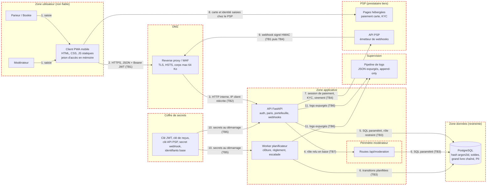
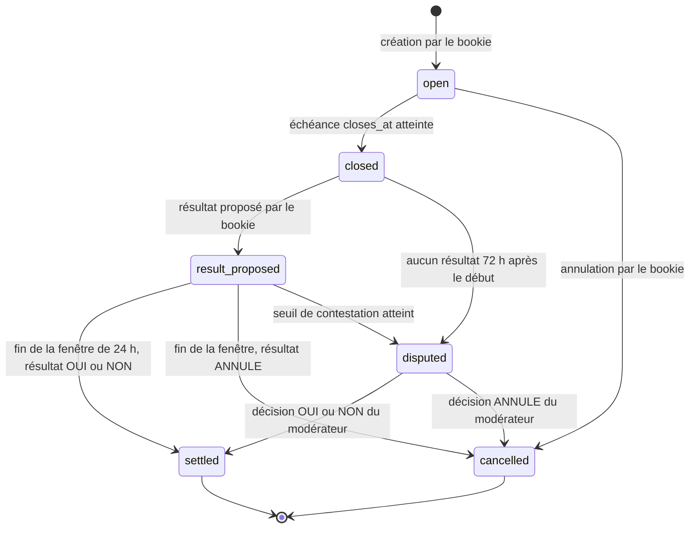
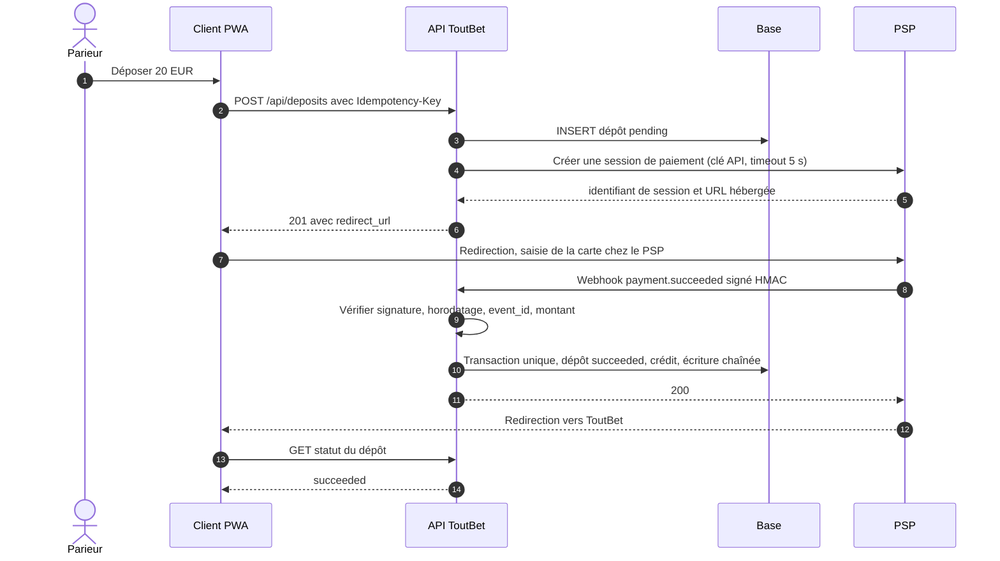
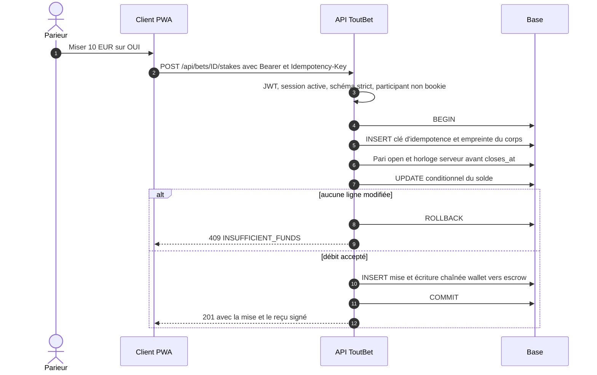
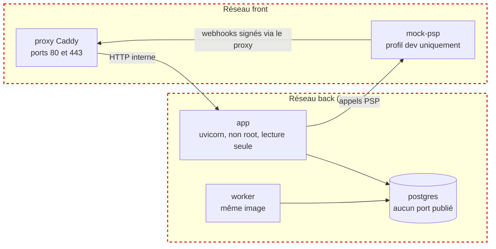

# ToutBet' : conception technique

Version 1.0 du 2026-11-25. Les diagrammes sont en Mermaid pour être versionnés avec le code et relus en diff. Toute modification d'un diagramme passe par une nouvelle version de ce fichier (voir l'historique en fin de document).

## 1. Choix techniques

| Sujet | Choix | Raison |
|---|---|---|
| API | Python 3.13, FastAPI, Pydantic v2 | validation déclarative des entrées, documentation OpenAPI désactivable en production |
| Base de données | SQLAlchemy 2 (mode synchrone), SQLite par défaut via `DATABASE_URL`, PostgreSQL via docker compose | requêtes paramétrées par défaut, même code sur les deux moteurs |
| Mots de passe | argon2id avec `argon2-cffi` | recommandé par l'OWASP, `passlib` n'est plus maintenu |
| Jetons | JWT HS256 avec `PyJWT`, 15 min, adossé à une session serveur | révocation possible à la déconnexion, `python-jose` n'est plus maintenu |
| Reçus de mise | signature Ed25519 avec `cryptography` | signature asymétrique, vérifiable par le joueur avec la clé publique |
| Limitation de débit | `slowapi` | limites par IP et par utilisateur, configurables |
| Appels au PSP | `httpx` avec timeouts explicites | pas d'appel bloquant sans limite |
| Dépendances | `uv`, `uv.lock` avec hash | installation reproductible, protège contre le typosquatting |
| Front | HTML, CSS et JavaScript sans framework ni CDN, fichiers séparés, servis par FastAPI | CSP stricte sans `unsafe-inline`, aucune dépendance JavaScript tierce |
| Proxy | Caddy (TLS) dans docker compose, WAF en production | terminaison TLS, taille maximale des requêtes |

## 2. Architecture et flux de données

Chaque zone encadrée en pointillés rouges est une zone de confiance. Un flux qui traverse un cadre rouge franchit une frontière de confiance (`TB1` à `TB7`, détaillées au §4).



| # | Flux | Données | Protection principale |
|---|---|---|---|
| 1 | Rôle vers client | identifiants, montants, résultats | contrôles côté client pour l'ergonomie seulement, jamais pour la sécurité |
| 2 | Client vers proxy | JSON, `Authorization: Bearer`, `Idempotency-Key` | TLS 1.2+, HSTS |
| 3 | Proxy vers API | idem, plus `X-Forwarded-For` | réseau interne, seule l'IP du proxy peut fixer l'IP client |
| 4 | API vers routes de modération | décision, justification | rôle `moderator` relu en base |
| 5 | API vers base | requêtes SQL | paramètres liés, rôle applicatif restreint, transactions |
| 6 | Worker vers base | transitions d'état, règlements | mises à jour conditionnelles, mêmes fonctions que l'API |
| 7 | API vers PSP | montant, référence interne du dépôt ou de l'utilisateur | clé API en en-tête, TLS vérifié, timeouts 2 s / 5 s, URL fixée par configuration |
| 8 | Client vers pages PSP | numéro de carte, pièce d'identité | hors de notre système (PCI-DSS SAQ-A) |
| 9 | PSP vers API (webhook) | `event_id`, type, référence, montant, devise | HMAC-SHA256 sur le corps brut avec horodatage |
| 10 | Coffre vers API et worker | secrets | lus au démarrage, gardés en mémoire seulement |
| 11 | API et worker vers logs | événements JSON | filtre de masquage avant émission |

## 3. Données sensibles

| Donnée | Emplacement | Protection |
|---|---|---|
| Hash des mots de passe | base, `users.password_hash` | argon2id (m = 19 MiB, t = 2, p = 1), jamais renvoyé ni journalisé |
| Clé de signature JWT | coffre, puis mémoire de l'API | au moins 256 bits, jamais en base ni dans le dépôt, la changer révoque tous les jetons |
| Clé privée des reçus (Ed25519) | coffre, puis mémoire de l'API | seule la clé publique est exposée |
| Clé API PSP, secret des webhooks | coffre, puis mémoire de l'API | jamais journalisés, rotation côté PSP |
| Identifiants de base | coffre, puis API et worker | rôle applicatif restreint, rôle propriétaire réservé à `toutbet-admin init-db` |
| Soldes | base, `wallets.balance_cents` | `CHECK (balance_cents >= 0)`, modifiés uniquement par `services/money.py`, réconciliés avec le grand livre |
| Grand livre et journal d'audit | base, `ledger_entries` et `audit_events` | append-only, chaîne SHA-256, aucun `UPDATE` ni `DELETE` pour le rôle applicatif |
| PII (email, date de naissance, statut KYC) | base, `users` | jamais exposées à un autre utilisateur, masquées dans les logs |
| Jetons d'invitation | base, `invitations.token_hash` | seul le hash SHA-256 est stocké |
| Sessions | base, `sessions` (sans le jeton) ; jeton côté client en mémoire et `sessionStorage` | jeton valable seulement avec la session active et le `jti` courant |
| Carte bancaire, pièce d'identité, IBAN | chez le PSP uniquement | ne transitent jamais par nos serveurs |

## 4. Frontières de confiance

| TB | Entre | Ce qui change | Contrôles au franchissement |
|---|---|---|---|
| TB1 | Internet (smartphone, PSP) et DMZ | on passe d'un réseau hostile à notre infrastructure, tout ce qui arrive peut être forgé | TLS 1.2+ uniquement, redirection HTTP vers HTTPS, HSTS, corps limité à 64 Ko, timeouts de lecture, hôtes autorisés, WAF et limite globale en production |
| TB2 | DMZ et zone applicative | la requête devient une action métier attribuée à une identité | seule l'IP du proxy est acceptée et peut fixer `X-Forwarded-For` ; JWT + session vérifiés ; schémas Pydantic `extra="forbid"` ; limites par IP et par utilisateur ; idempotence ; contrôle d'accès objet ; en sortie, en-têtes de sécurité et erreurs génériques |
| TB3 | zone applicative et zone données | l'application écrit l'état de référence, dont l'argent | rôle de base sans DDL ni `UPDATE`/`DELETE` sur `ledger_entries` et `audit_events` ; requêtes paramétrées ; transactions courtes ; mises à jour conditionnelles ; contraintes `CHECK` et `UNIQUE` ; base injoignable hors du réseau interne ; TLS en production |
| TB4 | plateforme et PSP | dialogue avec un tiers, dans les deux sens | sortant : URL fixée par configuration, TLS vérifié, clé API en en-tête, timeouts, aucune donnée personnelle inutile ; entrant : HMAC-SHA256 sur le corps brut, horodatage de moins de 5 min, comparaison à temps constant, `event_id` unique, rapprochement avec un enregistrement `pending` que nous avons créé ; le retour navigateur n'est jamais une preuve |
| TB5 | application et coffre de secrets | des secrets sortent du coffre | lecture au démarrage par l'identité du service seulement ; présence et longueur (32 octets minimum) vérifiées, sinon refus de démarrer ; jamais journalisés ni renvoyés |
| TB6 | application et pipeline de logs | des données quittent l'application vers un outil consulté par l'équipe | filtre de masquage avant émission, aucun corps de requête, identifiants internes au lieu des PII, pipeline append-only que l'application ne peut ni lire ni effacer |
| TB7 | parieur ou bookie et modérateur (frontière logique dans l'API) | on accède à un rôle qui décide de l'issue d'un pari | rôle relu en base à chaque requête, dépendance `require_moderator` sur tout le routeur, séparation des rôles (un modérateur ne mise pas et ne crée pas de pari), justification obligatoire, décision chaînée au journal d'audit ; MFA après le MVP |

## 5. Modèle de données

```mermaid
erDiagram
    USERS ||--|| WALLETS : "possède"
    USERS ||--o{ SESSIONS : "ouvre"
    USERS ||--o{ DEPOSITS : "effectue"
    USERS ||--o{ WITHDRAWALS : "demande"
    USERS ||--o{ BETS : "crée comme bookie"
    BETS ||--o{ INVITATIONS : "génère"
    BETS ||--o{ PARTICIPANTS : "rassemble"
    USERS ||--o{ PARTICIPANTS : "rejoint"
    BETS ||--o{ STAKES : "reçoit"
    USERS ||--o{ STAKES : "place"
    BETS ||--o{ CONTESTS : "subit"
    BETS ||--o| MODERATION_DECISIONS : "est tranché par"
    USERS ||--o{ IDEMPOTENCY_KEYS : "utilise"
    USERS ||--o{ LEDGER_ENTRIES : "initie"
    USERS ||--o{ AUDIT_EVENTS : "initie"

    USERS {
        uuid id PK
        string email UK "normalisé en minuscules"
        string password_hash "argon2id"
        string display_name UK
        date birth_date
        string role "user ou moderator"
        string kyc_status "none, pending, verified, rejected"
        int failed_login_count
        datetime locked_until
        datetime created_at
    }
    SESSIONS {
        uuid id PK "claim sid"
        uuid user_id FK
        uuid current_jti
        datetime created_at
        datetime expires_at "création + 8 h"
        datetime revoked_at
    }
    WALLETS {
        uuid user_id PK, FK
        int balance_cents "CHECK >= 0"
    }
    DEPOSITS {
        uuid id PK
        uuid user_id FK
        int amount_cents
        string currency "EUR"
        string status "pending, succeeded, failed"
        string psp_session_id UK
        string psp_event_id UK
        datetime created_at
    }
    WITHDRAWALS {
        uuid id PK
        uuid user_id FK
        int amount_cents
        string status "pending, sent, failed"
        string psp_payout_id UK
        datetime created_at
    }
    BETS {
        uuid id PK
        uuid bookie_id FK
        string title
        string description
        int min_stake_cents
        int bookie_commission_bps "0 à 1000"
        int platform_commission_bps "500"
        datetime event_starts_at
        datetime closes_at "avant event_starts_at"
        string status
        string proposed_outcome "OUI, NON, ANNULE"
        string proposal_note
        datetime contest_deadline
        string final_outcome
        bool bookie_fee_forfeited
        datetime settled_at
    }
    INVITATIONS {
        uuid id PK
        uuid bet_id FK
        string token_hash UK "SHA-256"
        datetime expires_at
        datetime used_at
        uuid used_by FK
    }
    PARTICIPANTS {
        uuid bet_id PK, FK
        uuid user_id PK, FK
        datetime joined_at
    }
    STAKES {
        uuid id PK
        uuid bet_id FK
        uuid user_id FK
        string outcome "OUI ou NON"
        int amount_cents "CHECK > 0"
        string ledger_hash
        datetime created_at
    }
    CONTESTS {
        uuid id PK
        uuid bet_id FK
        uuid user_id FK
        string reason
        datetime created_at
    }
    MODERATION_DECISIONS {
        uuid id PK
        uuid bet_id FK, UK
        uuid moderator_id FK
        string outcome
        string justification
        datetime created_at
    }
    LEDGER_ENTRIES {
        int seq PK
        datetime created_at
        string entry_type
        string from_account
        string to_account
        int amount_cents "CHECK > 0"
        uuid bet_id FK
        uuid actor_id FK
        uuid session_id
        string request_id
        string idempotency_key
        string prev_hash UK
        string hash UK
    }
    AUDIT_EVENTS {
        int seq PK
        datetime created_at
        string event_type
        uuid actor_id FK
        uuid bet_id FK
        string payload "JSON sans PII"
        string prev_hash UK
        string hash UK
    }
    CHAIN_HEADS {
        string name PK "ledger ou audit"
        int last_seq
        string last_hash
    }
    IDEMPOTENCY_KEYS {
        uuid user_id PK, FK
        string idempotency_key PK
        string endpoint
        string request_hash
        int status_code
        string response_body
        datetime created_at
    }
```



Invariants portés par la base (et testés) :

- `wallets.balance_cents >= 0` ; `stakes.amount_cents > 0` ; `ledger_entries.amount_cents > 0`.
- `bets.closes_at <= bets.event_starts_at` ; `bets.bookie_commission_bps` entre 0 et 1000 ; `bets.platform_commission_bps = 500`.
- `UNIQUE(bet_id, user_id)` sur `participants`, `stakes` et `contests` : un participant, une mise, une contestation.
- `UNIQUE` sur `deposits.psp_session_id`, `deposits.psp_event_id`, `invitations.token_hash`, `moderation_decisions.bet_id`, `ledger_entries.prev_hash`, `audit_events.prev_hash`.
- Tous les identifiants exposés sont des UUIDv4. Les numéros de séquence du grand livre restent internes.

## 6. Cycle de vie d'un pari



| Transition | Déclenchée par | Conditions vérifiées |
|---|---|---|
| création, vers `open` | bookie | paramètres valides (US-05), l'utilisateur n'est pas modérateur |
| `open` vers `closed` | planificateur (toutes les 30 s) | `now >= closes_at` ; toute mise vérifie aussi `now < closes_at`, indépendamment du planificateur |
| `open` vers `cancelled` | bookie | pari `open` ; remboursement intégral |
| `closed` vers `result_proposed` | bookie | `now >= event_starts_at`, aucune proposition existante ; `contest_deadline = now + 24 h` |
| `closed` vers `disputed` | planificateur | `now >= event_starts_at + 72 h` sans proposition |
| `result_proposed` vers `disputed` | contestation | mises des contestataires au moins égales à 10 % du total misé |
| `result_proposed` vers `settled` ou `cancelled` | planificateur | `now >= contest_deadline` et seuil non atteint |
| `disputed` vers `settled` ou `cancelled` | modérateur | décision et justification de 20 caractères minimum |

Chaque transition est une mise à jour conditionnelle `UPDATE bets SET status = :nouveau WHERE id = :id AND status = :attendu`. Si aucune ligne n'est modifiée, la transition est refusée (409 `INVALID_STATE`) et rien d'autre n'est écrit. C'est ce qui empêche un double règlement.

## 7. Séquestre, commissions et grand livre

### 7.1 Comptes et écritures

Le grand livre utilise quatre types de comptes : `wallet:<user_id>`, `escrow:<bet_id>`, `platform:revenue` et `psp:clearing` (contrepartie externe des dépôts et retraits).

| Écriture | De | Vers | Quand |
|---|---|---|---|
| `deposit` | `psp:clearing` | `wallet:<user>` | webhook `payment.succeeded` valide |
| `stake` | `wallet:<user>` | `escrow:<bet>` | mise acceptée |
| `refund` | `escrow:<bet>` | `wallet:<user>` | pari annulé |
| `payout` | `escrow:<bet>` | `wallet:<gagnant>` | règlement (mise + part du pot perdant) |
| `bookie_fee` | `escrow:<bet>` | `wallet:<bookie>` | règlement |
| `platform_fee` | `escrow:<bet>` | `platform:revenue` | règlement |
| `withdrawal` | `wallet:<user>` | `psp:clearing` | retrait accepté |
| `withdrawal_reversal` | `psp:clearing` | `wallet:<user>` | virement refusé par le PSP |

Seul `services/money.py` modifie `wallets.balance_cents`, et toujours dans la même transaction que l'écriture correspondante. Un débit est une seule requête :

```sql
UPDATE wallets
SET balance_cents = balance_cents - :amount
WHERE user_id = :user_id AND balance_cents >= :amount;
```

Si aucune ligne n'est modifiée, le solde est insuffisant et la transaction est annulée. Le solde n'est jamais lu en Python puis réécrit.

### 7.2 Règlement

Les commissions sont prises sur le pot perdant uniquement. Tous les calculs sont en entiers (centimes et points de base).

```text
W = somme des mises sur l'issue gagnante
L = somme des mises sur l'issue perdante

si résultat ANNULE, ou W = 0, ou L = 0 :
    rembourser chaque mise, aucune commission

platform_fee = floor(L * platform_bps / 10000)
bookie_fee   = floor(L * bookie_bps / 10000)    (0 si le modérateur a infirmé le bookie)
D            = L - platform_fee - bookie_fee     (à répartir entre gagnants)

pour chaque gagnant i :
    part_i  = floor(D * mise_i / W)
    reste_i = (D * mise_i) mod W
r = D - somme(part_i)                            (0 <= r < nombre de gagnants)
les r gagnants aux plus grands reste_i reçoivent 1 centime de plus
(à égalité, la mise la plus ancienne passe d'abord, puis le plus petit identifiant)

crédit_i = mise_i + part_i (+ 1 éventuel)

invariant : somme(crédit_i) + platform_fee + bookie_fee = W + L, séquestre final = 0
```

### 7.3 Exemple chiffré

Pari « Matis va-t-il réussir son créneau ? », commission bookie 400 points de base (4 %), plateforme 500 (5 %).

| Parieur | Issue | Mise (centimes) | Ordre de mise |
|---|---|---|---|
| Alice | OUI | 1 000 | 1 |
| Bob | OUI | 3 000 | 2 |
| Chloé | NON | 2 000 | 3 |
| David | NON | 1 500 | 4 |
| Emma | NON | 700 | 5 |

Résultat OUI, non contesté :

- W = 4 000, L = 4 200.
- `platform_fee` = floor(4 200 × 500 / 10 000) = 210.
- `bookie_fee` = floor(4 200 × 400 / 10 000) = 168.
- D = 4 200 - 210 - 168 = 3 822.
- Alice : 3 822 × 1 000 / 4 000 = 955,5, donc part 955 et reste 2 000.
- Bob : 3 822 × 3 000 / 4 000 = 2 866,5, donc part 2 866 et reste 2 000.
- r = 3 822 - 3 821 = 1. Les restes sont égaux, Alice a misé en premier : elle reçoit le centime.
- Crédits : Alice 1 000 + 956 = 1 956, Bob 3 000 + 2 866 = 5 866.
- Contrôle : 1 956 + 5 866 + 210 + 168 = 8 200 = 4 000 + 4 200.

Variante : le bookie avait proposé NON, le pari a été contesté et le modérateur a tranché OUI. La commission du bookie est annulée : D = 3 990, Alice reçoit 1 000 + 998 = 1 998, Bob 3 000 + 2 992 = 5 992, la plateforme 210. Contrôle : 1 998 + 5 992 + 210 = 8 200.

Ces deux cas sont repris tels quels dans les tests (`test_settlement_worked_example`).

### 7.4 Chaînage du grand livre et du journal d'audit

- `hash = SHA-256(prev_hash || json_canonique(écriture sans hash))`, avec un JSON aux clés triées, sans espaces, en UTF-8, et des dates ISO 8601 UTC à la microseconde.
- La première écriture a `prev_hash` = 64 zéros.
- La table `chain_heads` contient une ligne par chaîne (`ledger`, `audit`). Chaque ajout verrouille cette ligne (`SELECT ... FOR UPDATE` sur PostgreSQL, transaction `BEGIN IMMEDIATE` sur SQLite), ce qui sérialise les ajouts. `UNIQUE(prev_hash)` empêche toute bifurcation de la chaîne.
- Le worker journalise toutes les 5 minutes l'événement `ledger.head` (numéro et hash de tête). Ce hash part dans le pipeline de logs, hors de portée de l'application : une réécriture complète de la chaîne devient visible.
- `toutbet-admin verify-ledger` recalcule les deux chaînes, vérifie que chaque solde est égal à la somme des écritures de son compte, que chaque écriture `deposit` correspond à un dépôt `succeeded` de même montant, et que le séquestre des paris réglés ou annulés vaut 0. Il s'arrête sur la première anomalie avec un code de sortie non nul.

Limite assumée : le verrou de tête sérialise toutes les opérations financières. Chaque transaction étant courte, c'est suffisant pour le MVP. Le test de charge de l'atelier 2 dira si une chaîne par pari devient nécessaire.

### 7.5 Reçus de mise

À chaque mise, l'API renvoie un reçu :

- `payload` : JSON canonique `{receipt_version, stake_id, bet_id, user_id, outcome, amount_cents, created_at, ledger_hash}` ;
- `signature` : Ed25519 sur `payload`, encodée en base64url ;
- `key_id` : 16 premiers caractères hexadécimaux du SHA-256 de la clé publique.

`GET /api/receipts/public-key` renvoie `{key_id, algorithm: "Ed25519", public_key}`. Le joueur peut prouver que la plateforme a accepté sa mise, et la plateforme peut prouver qu'elle a été passée depuis la session du joueur (écriture chaînée avec `session_id` et `request_id`).

## 8. Flux critiques

### 8.1 Dépôt



### 8.2 Mise



### 8.3 Idempotence

Les routes `POST /api/deposits`, `POST /api/withdrawals` et `POST /api/bets/{id}/stakes` exigent un en-tête `Idempotency-Key` (UUID). Dans la transaction de l'opération, l'API insère d'abord `(user_id, idempotency_key, endpoint, request_hash)` :

- insertion réussie : l'opération s'exécute et la réponse est enregistrée dans la même transaction ;
- conflit d'unicité avec la même empreinte : la réponse enregistrée est renvoyée telle quelle, avec l'en-tête `Idempotent-Replayed: true` ;
- conflit avec une empreinte différente : 422 `IDEMPOTENCY_KEY_REUSED` ;
- conflit sur une opération encore en cours : 409 `IDEMPOTENCY_IN_PROGRESS`.

Les clés sont purgées après 24 h. Pour les webhooks, c'est `event_id` (unique) qui joue ce rôle.

### 8.4 Webhook PSP

En-tête `X-PSP-Signature: t=<timestamp unix>,v1=<hex>` avec `v1 = HMAC-SHA256(PSP_WEBHOOK_SECRET, "<t>." + corps brut)`. L'API vérifie la signature sur les octets bruts avant tout parsing JSON, rejette un `t` à plus de 300 s de l'heure serveur, compare avec `hmac.compare_digest`, puis traite l'événement :

| Type | Effet |
|---|---|
| `payment.succeeded` | dépôt `pending` de même `psp_session_id`, montant et devise : passage à `succeeded` et crédit |
| `payment.failed` | dépôt `pending` : passage à `failed` |
| `kyc.verified` / `kyc.rejected` | statut KYC de l'utilisateur référencé |

Un `event_id` déjà vu renvoie 200 sans effet, pour que le PSP arrête de réessayer.

## 9. API

Toutes les routes sont sous `/api`, en JSON. Une route exige un jeton valide sauf si elle figure dans la liste des routes publiques : `POST /api/auth/register`, `POST /api/auth/login`, `POST /api/webhooks/psp`, `GET /api/receipts/public-key`, plus `GET /healthz` et les fichiers statiques.

| Méthode et chemin | Accès | Idempotency-Key | Limite par défaut |
|---|---|---|---|
| `POST /api/auth/register` | public | non | 5 / h par IP |
| `POST /api/auth/login` | public | non | 5 / min par IP, verrouillage du compte après 10 échecs |
| `POST /api/auth/refresh` | authentifié | non | 30 / min |
| `POST /api/auth/logout` | authentifié | non | écriture |
| `GET /api/me` | authentifié | | lecture |
| `GET /api/wallet` | authentifié, son portefeuille | | lecture |
| `POST /api/deposits` | utilisateur `user` | oui | écriture |
| `GET /api/deposits/{id}` | propriétaire | | lecture |
| `POST /api/kyc/start` | utilisateur `user` | non | 5 / h |
| `POST /api/withdrawals` | utilisateur `user` KYC `verified`, mot de passe ressaisi | oui | 5 / h |
| `POST /api/bets` | utilisateur `user` | non | écriture |
| `GET /api/bets` | ses paris (bookie ou participant), filtres `status` et `role` en liste blanche | | lecture |
| `GET /api/bets/{id}` | bookie ou participant | | lecture |
| `POST /api/bets/{id}/cancel` | bookie, pari `open` | non | écriture |
| `POST /api/bets/{id}/invitations` | bookie, pari `open` | non | écriture |
| `POST /api/invitations/accept` | utilisateur `user`, ni bookie du pari ni déjà participant | non | 10 / min |
| `POST /api/bets/{id}/stakes` | participant, pas le bookie | oui | écriture |
| `POST /api/bets/{id}/result` | bookie | non | écriture |
| `POST /api/bets/{id}/contests` | participant ayant misé | non | écriture |
| `GET /api/moderation/disputes` | `moderator` | | lecture |
| `GET /api/moderation/bets/{id}` | `moderator`, pari `disputed` | | lecture |
| `POST /api/moderation/bets/{id}/decision` | `moderator` | non | écriture |
| `POST /api/webhooks/psp` | PSP, signature HMAC | `event_id` | 300 / min par IP |
| `GET /api/receipts/public-key` | public | | lecture |

« Écriture » vaut 20 requêtes par minute et par utilisateur, « lecture » 120. Toutes les limites sont configurables par variables d'environnement. Le jeton d'invitation voyage dans le fragment de l'URL (`/#/invite/<jeton>`) puis dans le corps de `POST /api/invitations/accept`, jamais dans une URL envoyée au serveur.

Format unique des erreurs :

```json
{"error": {"code": "BET_CLOSED", "message": "Les mises sont closes pour ce pari.", "request_id": "6f1c..."}}
```

| HTTP | Codes |
|---|---|
| 400 | `INVALID_SIGNATURE` (webhook) |
| 401 | `UNAUTHENTICATED` |
| 403 | `FORBIDDEN`, `KYC_REQUIRED`, `BOOKIE_CANNOT_STAKE` |
| 404 | `NOT_FOUND` (aussi pour une ressource existante mais non visible) |
| 405 | `METHOD_NOT_ALLOWED` |
| 409 | `INSUFFICIENT_FUNDS`, `BET_CLOSED`, `INVALID_STATE`, `ALREADY_STAKED`, `ALREADY_CONTESTED`, `CONTEST_WINDOW_CLOSED`, `INVITATION_LIMIT`, `IDEMPOTENCY_IN_PROGRESS` |
| 413 | `PAYLOAD_TOO_LARGE` |
| 422 | `VALIDATION_ERROR` (liste des champs, sans les valeurs reçues), `IDEMPOTENCY_KEY_REUSED` |
| 429 | `RATE_LIMITED`, avec `Retry-After` |
| 500 | `INTERNAL_ERROR` |
| 503 | `PSP_UNAVAILABLE`, `FEATURE_DISABLED` |

## 10. Authentification et sessions

- Inscription : email normalisé (espaces retirés, minuscules), pseudonyme unique, 18 ans révolus. La réponse est toujours `202 {"status": "accepted"}`, que l'email soit libre ou non, et le mot de passe est haché dans les deux cas.
- Connexion : la limite par IP passe avant tout calcul. Email inconnu : vérification contre un hash factice de même coût. Compte verrouillé : même réponse 401. Dix échecs en 15 minutes verrouillent le compte 15 minutes. En cas de succès, le compteur est remis à zéro et une session est créée (`expires_at` = maintenant + 8 h).
- Jeton : JWT HS256, claims `sub`, `sid`, `jti`, `iat`, `exp` (`iat` + 900 s), `iss = "toutbet"`, `aud = "toutbet-api"`. Décodage avec `algorithms=["HS256"]`, audience, émetteur et claims obligatoires. Puis la session doit exister, ne pas être révoquée ni expirée, et `sessions.current_jti` doit égaler `jti`. Le rôle est lu dans `users`, jamais dans le jeton.
- Renouvellement : génère un nouveau `jti` pour la même session, l'ancien jeton devient invalide.
- Déconnexion : `revoked_at` = maintenant.
- Côté front : jeton en mémoire et dans `sessionStorage`, envoyé dans `Authorization`. Jamais dans `localStorage`, jamais dans une URL, aucun cookie d'authentification, donc pas de surface CSRF.
- Retrait : le mot de passe est redemandé et vérifié (ré-authentification).
- Modérateurs : `toutbet-admin create-moderator --email ...`, mot de passe lu avec `getpass`, jamais passé en argument de ligne de commande.

## 11. En-têtes HTTP, CORS et hôtes

Sur toutes les réponses (API et fichiers statiques) :

| En-tête | Valeur |
|---|---|
| `Strict-Transport-Security` | `max-age=63072000; includeSubDomains` |
| `Content-Security-Policy` | `default-src 'none'; script-src 'self'; style-src 'self'; img-src 'self' data:; connect-src 'self'; font-src 'self'; manifest-src 'self'; base-uri 'none'; form-action 'self'; frame-ancestors 'none'` |
| `X-Content-Type-Options` | `nosniff` |
| `Referrer-Policy` | `no-referrer` |
| `Permissions-Policy` | `camera=(), microphone=(), geolocation=(), payment=()` |
| `Cross-Origin-Opener-Policy` | `same-origin` |
| `Cross-Origin-Resource-Policy` | `same-origin` |
| `X-Frame-Options` | `DENY` |
| `Cache-Control` | `no-store` sur `/api/*` |

Pas d'en-tête `Server` (uvicorn lancé avec `--no-server-header`). CORS : liste blanche `CORS_ORIGINS`, vide par défaut (front servi par la même origine), jamais `*`, pas de credentials, méthodes `GET` et `POST`, en-têtes `Authorization`, `Content-Type` et `Idempotency-Key`. `TrustedHostMiddleware` avec `ALLOWED_HOSTS`. Corps limité à 64 Ko par le proxy et par un middleware applicatif.

## 12. Journalisation et événements de sécurité

Une ligne JSON par événement sur la sortie standard : `ts` (UTC), `level`, `event`, `request_id`, `user_id`, `client_ip`, `method`, `route` (gabarit de route, pas l'URL brute), `status`, `duration_ms`, puis les champs propres à l'événement. Le `request_id` est aussi renvoyé dans l'en-tête `X-Request-ID` et stocké dans les écritures du grand livre.

Le filtre de masquage remplace par `***` la valeur de toute clé contenant `password`, `secret`, `token`, `authorization`, `api_key`, `signature`, `card`, `pan`, `cvv` ou `iban` (sans tenir compte de la casse), ainsi que toute valeur ressemblant à un JWT (`eyJ...`) ou à un numéro de carte (13 à 19 chiffres). Les emails sont réduits à `a***@domaine`. Aucun corps de requête ou de réponse n'est journalisé.

| Événement | Émis quand | Piste d'alerte (atelier 4) |
|---|---|---|
| `auth.login_failed` | échec de connexion | plus de 20 par minute depuis une IP |
| `auth.account_locked` | verrouillage d'un compte | toute occurrence sur un modérateur |
| `auth.token_rejected` | jeton invalide, expiré ou révoqué | pic soudain |
| `authz.denied` | 403, ou 404 sur une ressource existante non visible | plus de 30 par minute pour un utilisateur (balayage d'IDOR) |
| `rate_limit.exceeded` | réponse 429 | hausse combinée avec la CPU |
| `psp.webhook_rejected` | signature ou horodatage invalide | 3 en 5 minutes, critique |
| `psp.amount_mismatch` | montant ou devise différents du dépôt | toute occurrence, critique |
| `psp.timeout` | PSP hors délai | plus de 5 % des appels |
| `money.stake_rejected` | mise refusée, avec la raison | rafale d'`INSUFFICIENT_FUNDS` pour un même utilisateur |
| `money.withdrawal_failed` | virement refusé | toute occurrence |
| `bet.disputed` | pari en litige | file de litiges qui grossit |
| `moderation.decision` | décision rendue | décision sur un pari où le modérateur a un lien |
| `ledger.head` | toutes les 5 minutes | absent depuis plus de 10 minutes |
| `ledger.verify_failed` | anomalie détectée | toute occurrence, critique |
| `error.unhandled` | erreur 500 | plus de 1 % des requêtes |

## 13. Configuration et secrets

La configuration est lue une fois au démarrage avec `pydantic-settings`. En production, les variables sont injectées par la plateforme à partir du coffre de secrets. En local, elles viennent de `.env`, ignoré par Git depuis le premier commit, avec un `.env.example` qui ne contient que des valeurs factices.

| Variable | Rôle | Défaut |
|---|---|---|
| `ENV` | `dev`, `test` ou `prod` ; la documentation OpenAPI n'est servie qu'en `dev` | `prod` |
| `DATABASE_URL` | base, rôle applicatif restreint | `sqlite:///./toutbet.db` |
| `DATABASE_ADMIN_URL` | rôle propriétaire, pour `toutbet-admin init-db` uniquement | aucun |
| `JWT_SECRET` | clé HS256, 32 octets minimum | aucun, obligatoire |
| `RECEIPT_SIGNING_KEY` | graine Ed25519 de 32 octets en base64url | aucun, obligatoire |
| `PSP_BASE_URL`, `PSP_API_KEY` | API du PSP | aucun, obligatoire |
| `PSP_WEBHOOK_SECRET` | secret HMAC des webhooks, 32 octets minimum | aucun, obligatoire |
| `PUBLIC_BASE_URL` | construction des liens d'invitation et de l'URL de retour PSP | aucun, obligatoire |
| `ALLOWED_HOSTS`, `CORS_ORIGINS`, `TRUSTED_PROXY_IPS` | hôtes, origines et proxys de confiance | `localhost`, vide, `127.0.0.1` |
| `RATE_LIMIT_*` | limites du §9 | valeurs du §9 |
| `BET_CREATION_ENABLED`, `STAKES_ENABLED`, `DEPOSITS_ENABLED`, `WITHDRAWALS_ENABLED` | interrupteurs de fonctionnalités, 503 `FEATURE_DISABLED` si désactivé | `true` |

Sans secret obligatoire, ou avec un secret trop court, l'application refuse de démarrer avec un message qui nomme la variable sans afficher sa valeur.

## 14. Déploiement de développement



- `app` est relié aux deux réseaux, `worker` et `postgres` seulement au réseau interne.
- `init-db` est un service ponctuel qui crée le schéma avec `DATABASE_ADMIN_URL` puis applique `deploy/postgres/grants.sql` : le rôle applicatif a `SELECT, INSERT, UPDATE` sur les tables métier, seulement `SELECT, INSERT` sur `ledger_entries` et `audit_events`, aucun droit DDL.
- Conteneurs `app` et `worker` : utilisateur non root, système de fichiers en lecture seule avec un `tmpfs` pour `/tmp`.

## Historique

| Version | Date | Changement |
|---|---|---|
| 1.0 | 2026-11-25 | première version (atelier 1) |
